<h1 align="center">rozkład-mcp 🚆🚌</h1>

<p align="center">
  <b>Rozkład jazdy PKP, PKS i komunikacji miejskiej dla Twojego asystenta AI.</b><br>
  Serwer <a href="https://modelcontextprotocol.io">MCP</a>: wyszukiwarka połączeń z przesiadkami, odjazdy, opóźnienia na żywo i ceny biletów – w Claude, ChatGPT, Cursorze, VS Code i każdym kliencie MCP.
</p>

<p align="center">
  <a href="https://www.npmjs.com/package/rozklad-mcp"></a>
  <a href="https://registry.modelcontextprotocol.io/v0/servers?search=rozklad-mcp"></a>
  <a href="https://github.com/ContentWriterco/rozklad-mcp/actions/workflows/ci.yml"></a>
  <a href="LICENSE"></a>
  
</p>

<p align="center">
  
</p>

<p align="center">
  <a href="#najszybciej-publiczny-serwer-bez-instalacji"><b>Podłącz w 30 sekund</b></a> ·
  <a href="#przykładowe-pytania">Przykładowe pytania</a> ·
  <a href="#instalacja-lokalna">Instalacja lokalna</a> ·
  <a href="#english">English</a>
</p>

Wszystkie pociągi w Polsce (PKP Intercity, Polregio, Koleje Mazowieckie, SKM, Koleje Śląskie, Dolnośląskie, Wielkopolskie, Małopolskie, ŁKA, Arriva…), autobusy PKS, FlixBus i komunikacja miejska ~25 miast w jednej wyszukiwarce połączeń. **Bez klucza API, bez rejestracji, za darmo** – tylko otwarte dane przewoźników i zarządców.

### Przykładowe pytania

- „Jak dostanę się jutro na 9:00 z Wrocławia do Zakopanego?”
- „Czym najszybciej z Gdyni Orłowo na Politechnikę Gdańską?”
- „Ile kosztuje IC z Poznania do Warszawy w piątek po 16:00?”
- „Co odjeżdża teraz z przystanku Kraków Rondo Mogilskie?”
- „Którędy jedzie Podhalanin i ile ma opóźnienia?”
- „Mam pociąg o 18:36 z Poznania Głównego – o której autobus z Niepruszewa, żeby zdążyć?”

## Co potrafi

| Narzędzie | Do czego |
|---|---|
| `plan_journey` | Połączenia A → B z przesiadkami **pociąg ↔ autobus**, „wyjazd po” albo „przyjazd do”, limit przesiadek, wybór środków transportu. Miejsce = stacja, całe miasto („Kraków”) albo współrzędne. |
| `departures` | Tablica odjazdów/przyjazdów z peronami i opóźnieniami; filtr „tylko w kierunku Poznania”. |
| `trip_details` | Cały przebieg pociągu (po numerze: `3510`, `IC 3510`, nazwie: `Podhalanin` albo `ref`) z opóźnieniem na każdej stacji, odwołaniami i objazdami. |
| `find_stops` / `nearby_stops` | Wyszukiwanie stacji (literówki i brak polskich znaków OK) oraz przystanków w pobliżu punktu. |
| `rail_disruptions` | Utrudnienia na kolei z PKP PLK: zamknięcia torów, komunikacja zastępcza (ZKA), odwołania (wymaga klucza API PLK na serwerze). |
| `data_sources` | Jakie dane są załadowane, do kiedy ważne, licencje i wymagane atrybucje. |

**Pokrycie (domyślnie):** wszyscy przewoźnicy kolejowi koordynowani przez PKP PLK – PKP Intercity, Polregio, Koleje Mazowieckie, SKM Trójmiasto, SKM Warszawa, Koleje Śląskie, Dolnośląskie, Wielkopolskie, Małopolskie, ŁKA, Arriva, RegioJet, Leo Express – plus WKD, **PKS Poznań, PKS Kalisz i przewoźnicy kaliscy, Sindbad, Kombus, FlixBus/FlixTrain (połączenia z i do Polski)**. Komunikacja miejska ~25 miast (Warszawa, Kraków, Łódź, Poznań, Trójmiasto, GZM, Szczecin, Lublin, Białystok, Bydgoszcz, Legnica…) – na publicznym serwerze włączona, lokalnie opcjonalna. Przystanki miejskie wyszukasz z nazwą miasta: „Kraków Rondo Mogilskie”, „Warszawa Politechnika”. Pełna lista: [`feeds/feeds.json`](feeds/feeds.json).

Opóźnienia na żywo: wszystkie pociągi (dane PKP PLK) oraz komunikacja miejska Krakowa, Poznania, Gdańska i Szczecina (GTFS-Realtime). Utrudnienia i komunikacja zastępcza z API PKP PLK, gdy serwer ma klucz (`ROZKLAD_PLK_API_KEY`).

**Ceny:** `plan_journey` podaje cenę z oficjalnego cennika przewoźnika dla **PKP Intercity** (TLK/IC według odległości po torze, EIC/EIP według par stacji) oraz **Polregio, Kolei Mazowieckich, Śląskich, Dolnośląskich, Małopolskich, ŁKA i Arrivy** (bilet normalny, 2. klasa, według odległości). Gdy odległość wypada blisko granicy przedziału cennika, podajemy widełki, np. 68–69 zł – przebieg toru w danych różni się od odległości taryfowej o kilka km. To **cena maksymalna** biletu normalnego (bez ulg i promocji); w sprzedaży często jest niższa – rabaty PKP IC, taryfy wojewódzkie (np. Taryfa Pomorska, Małopolska) i oferty przewoźników. Cenniki są informacją publiczną wykorzystywaną na podstawie art. 5 ustawy o otwartych danych. Aktualizacja: `npm run build-fares -- <cennik.pdf> <url> <obowiązuje-od>` (PKP IC) i `python3 scripts/build-regional-fares.py` (przewoźnicy regionalni). Brak cen: komunikacja miejska, autobusy, SKM, Koleje Wielkopolskie (nie znaleźliśmy aktualnego cennika) – PR mile widziane.

## Najszybciej: publiczny serwer (bez instalacji)

Adres MCP: **`https://rozklad.compabase.com/mcp`** (Streamable HTTP, bez logowania, limit 60 zapytań/min na IP).

- **Claude (web/desktop):** Ustawienia → Connectors → *Add custom connector* → wklej adres.
- **ChatGPT:** Settings → Connectors (tryb deweloperski) → dodaj serwer MCP z tym adresem.
- **Claude Code:** `claude mcp add --transport http rozklad https://rozklad.compabase.com/mcp`
- **Cursor / VS Code:** `{"mcpServers": {"rozklad": {"url": "https://rozklad.compabase.com/mcp"}}}`

Serwer hostuje [Compabase](https://compabase.com) pro publico bono, ze wszystkimi feedami (pociągi, PKS, FlixBus, komunikacja miejska). Przy intensywnym użyciu uruchom lokalnie (niżej).

Prywatność: publiczny serwer liczy wyłącznie zagregowane statystyki dzienne – ile razy użyto każdego narzędzia, z jakim skutkiem (np. „nie znaleziono miejsca”), nazwy klientów MCP i liczbę unikalnych użytkowników (sól zmieniana codziennie, trzymana tylko w pamięci). Nie zapisujemy adresów IP, współrzędnych ani tras. Podgląd: [`/stats`](https://rozklad.compabase.com/stats).

## Instalacja lokalna

Potrzebujesz Node.js ≥ 20. Zanim paczka trafi na npm, zamiast `rozklad-mcp` w poleceniach poniżej użyj `github:ContentWriterco/rozklad-mcp` (np. `npx -y github:ContentWriterco/rozklad-mcp`). Pierwsze uruchomienie pobiera ~40 MB rozkładów (potem cache i automatyczne odświeżanie co 12 h).

### Claude Desktop

`Settings → Developer → Edit Config` i dopisz:

```json
{
  "mcpServers": {
    "rozklad": {
      "command": "npx",
      "args": ["-y", "rozklad-mcp"]
    }
  }
}
```

### Claude Code

```bash
claude mcp add rozklad --scope user -- npx -y rozklad-mcp
```

### Cursor / Windsurf

`~/.cursor/mcp.json` (Windsurf: `~/.codeium/windsurf/mcp_config.json`) – ten sam JSON co dla Claude Desktop.

### VS Code (Copilot)

`.vscode/mcp.json`:

```json
{ "servers": { "rozklad": { "type": "stdio", "command": "npx", "args": ["-y", "rozklad-mcp"] } } }
```

### OpenAI Codex CLI

`~/.codex/config.toml`:

```toml
[mcp_servers.rozklad]
command = "npx"
args = ["-y", "rozklad-mcp"]
tool_timeout_sec = 120
```

### Zdalnie (HTTP) – ChatGPT, agenci w chmurze, n8n

```bash
npx -y rozklad-mcp --http --port 3000 --host 0.0.0.0
# endpoint: http://twoj-serwer:3000/mcp   (Streamable HTTP, bezstanowy)   health: /health
```

albo Docker:

```bash
docker build -t rozklad-mcp .
docker run -p 3000:3000 -v rozklad-cache:/data rozklad-mcp
```

### Z kodu źródłowego

```bash
git clone https://github.com/ContentWriterco/rozklad-mcp && cd rozklad-mcp
npm install && npm run build
node dist/index.js plan "Zbąszyń" "Kraków" --date jutro --time 7:00
```

## Konfiguracja

Zmienne środowiskowe (w JSON-ie klienta: `"env": { "ROZKLAD_FEEDS": "trains,regional,city:Poznań" }`):

| Zmienna | Domyślnie | Opis |
|---|---|---|
| `ROZKLAD_FEEDS` | `trains,regional` | Grupy (`trains`, `regional`/`pks`, `city`), pojedyncze feedy (`warszawa`), miasta (`city:Kraków`), regiony (`region:wielkopolskie`), `all`, wykluczenia (`-sindbad`). |
| `ROZKLAD_EXTRA_FEEDS` | – | Własne pliki GTFS: `moj-pks=https://…/gtfs.zip;inny=https://…` |
| `ROZKLAD_FEEDS_FILE` | – | Własny rejestr feedów (np. w forku dla jednego regionu). |
| `ROZKLAD_MIN_TRANSFER` | `4` | Minimalny czas przesiadki (min). |
| `ROZKLAD_MAX_WALK_M` | `500` | Maks. dojście pieszo między przystankami przy przesiadce. |
| `ROZKLAD_REFRESH_HOURS` | `12` | Jak często sprawdzać nowe rozkłady. |
| `ROZKLAD_LIVE` | `1` | `0` wyłącza opóźnienia na żywo. |
| `ROZKLAD_CACHE_DIR` | cache systemu | Gdzie trzymać pobrane rozkłady. |
| `ROZKLAD_PLK_API_KEY` | – | Klucz [Otwartych Danych Kolejowych PKP PLK](https://pdp-api.plk-sa.pl/) – włącza utrudnienia i komunikację zastępczą. |
| `ROZKLAD_CONN_CACHE_MB` | `400` | Budżet pamięci na tablice połączeń dla kolejnych dni. |
| `ROZKLAD_STATS` | – | Tryb HTTP: `1` = anonimowe dzienne liczniki użycia pod `/stats`. |

**Pamięć:** domyślny zestaw (pociągi + PKS) ≈ 300–500 MB RAM i ~10 s startu. Komunikacja miejska dużych miast jest cięższa (Warszawa ≈ +250 MB, wszystkie miasta razem ≈ 1,2 GB i ~70 s startu), dlatego lokalnie włączasz ją świadomie, np. `trains,regional,city:Warszawa`.

## CLI (bez agenta)

```bash
rozklad-mcp plan "Warszawa" "Gdańsk" --date piątek --time 16:00
rozklad-mcp plan "Zbąszyń" "Gdańsk Główny" --time 9:00 --arrive-by
rozklad-mcp departures "Poznań Główny" --direction Wrocław --duration 180
rozklad-mcp trip "IC 3510" --date jutro
rozklad-mcp stops "szklarska"
rozklad-mcp sources
```

## Skąd dane? (i dlaczego bez klucza)

Wszystko pochodzi z **otwartych danych publikowanych przez przewoźników i zarządców** (ponowne wykorzystywanie informacji sektora publicznego, [Krajowy Punkt Dostępowy MMTIS](https://dane.gov.pl/pl/dataset/1739,krajowy-punkt-dostepowy-kpd-multimodalne-usugi-informacji-o-podrozach)):

- Pociągi: [Otwarte Dane Kolejowe PKP PLK](https://pdp-api.plk-sa.pl/) w formacie GTFS przygotowywanym przez [Mikołaja Kuranowskiego](https://mkuran.pl/gtfs/) ([PolishTrainsGTFS](https://github.com/MKuranowski/PolishTrainsGTFS)) – dzięki temu nie potrzebujesz własnego klucza API.
- Autobusy i miasta: pliki GTFS przewoźników i zarządów transportu (linki i licencje w [`feeds/feeds.json`](feeds/feeds.json)).

Serwer **nie scrapuje** stron przewoźników. Odpowiedzi zawierają wymagane atrybucje źródeł. Dane bywają niekompletne (np. zmiany w ostatniej chwili, autobusowa komunikacja zastępcza) – przed ważną podróżą sprawdź u przewoźnika.

## Brakuje Twojego PKS-u albo miasta? 🙋

To najprostszy i najcenniejszy sposób, żeby pomóc. Większość PKS-ów nie publikuje jeszcze danych – ale coraz więcej musi (rozporządzenie UE 2017/1926). Jeśli znasz link do pliku GTFS:

1. dopisz wpis do [`feeds/feeds.json`](feeds/feeds.json) (szablon w [CONTRIBUTING.md](CONTRIBUTING.md)),
2. `npm run check-feeds` – sprawdzi, czy link działa,
3. otwórz Pull Request.

Nie programujesz? Otwórz [zgłoszenie „Dodaj przewoźnika”](../../issues/new?template=nowy-przewoznik.yml) z linkiem albo nazwą firmy – albo napisz do przewoźnika, żeby opublikował GTFS w KPD.

**Szukamy pomocy:** Wrocław (blokuje pobieranie automatyczne), Zielona Góra i Leszno (linki z KPD nie działają), Olsztyn, Częstochowa, PKS-y w całej Polsce, GTFS-Realtime kolejnych miast, aktualny cennik Kolei Wielkopolskich.

## Jak to działa

- GTFS (pociągi + autobusy + miasta) łączony w jedną sieć w pamięci; przystanki tej samej stacji grupowane, przystanki w promieniu 500 m łączone przejściem pieszym – stąd przesiadki pociąg ↔ PKS na dworcach.
- Wyszukiwanie: [Connection Scan Algorithm](https://arxiv.org/abs/1703.05997) w wariancie wielokryterialnym (czas przyjazdu × liczba przesiadek) – kilkadziesiąt ms na zapytanie dla całej Polski.
- Opóźnienia: JSON z danymi PKP PLK (pociągi) i GTFS-Realtime miast (własny dekoder protobuf, bez zależności), cache 60–90 s.
- Zero natywnych zależności (działa na macOS/Windows/Linux/ARM), ~3 tys. linii TypeScriptu – łatwo zrozumieć i rozbudować.

## Rozwój

```bash
npm install
npm test            # build + testy (bez internetu, na syntetycznej sieci)
npm run check-feeds # czy wszystkie linki w rejestrze działają
ROZKLAD_LOG=debug node dist/index.js plan "A" "B"
```

Pomysły na rozwój: taryfy wojewódzkie (Pomorska, Małopolska, Kujawsko-Pomorska) i ceny biletów miejskich, opóźnienia na żywo w wyszukiwaniu połączeń, mapy tras (shapes), utrwalony indeks dla szybszego startu.

## Licencja

Kod: [MIT](LICENSE). Dane: na licencjach źródeł – patrz `data_sources` i [`feeds/feeds.json`](feeds/feeds.json). Projekt niezależny, niezwiązany z Grupą PKP ani przewoźnikami.

---

## English

<p align="center"></p>

**rozklad-mcp** is an MCP server that gives AI assistants and agents **Polish public transport timetables**: every train in Poland (all carriers dispatched by PKP PLK – PKP Intercity, Polregio, Koleje Mazowieckie, SKM, regional railways), PKS/regional buses that publish open data, FlixBus/FlixTrain services to and from Poland, and urban transit in ~25 cities (Warsaw, Kraków, Łódź, Poznań, Gdańsk/Gdynia, Silesia GZM, Szczecin, Lublin, Białystok…).

- `plan_journey` – multi-criteria connection scan with train ↔ bus ↔ tram transfers, depart-after / arrive-by, coordinates as endpoints, published price-list fares of PKP Intercity and regional rail carriers
- `departures` – live departure board with platforms and delays
- `trip_details` – full route of a train or bus with live delays and cancellations (trains; city transit in Kraków, Poznań, Gdańsk, Szczecin)
- `rail_disruptions` – PKP PLK track closures and replacement buses
- `find_stops`, `nearby_stops`, `data_sources`

**Try it in 30 seconds:** add `https://rozklad.compabase.com/mcp` as a custom connector in Claude or ChatGPT, or run `claude mcp add --transport http rozklad https://rozklad.compabase.com/mcp`. Locally: `npx -y rozklad-mcp` (stdio) in any MCP client, or `--http` for a Streamable HTTP endpoint. No API key – open GTFS data (PKP PLK via mkuran.pl, carriers' and cities' own feeds). Station names work with or without Polish diacritics; a bare town name means all of its stops.

Example prompts: *"How do I get from Wrocław to Zakopane by 9 am tomorrow?"*, *"What leaves Kraków Rondo Mogilskie now?"*, *"How much is the IC from Poznań to Warsaw on Friday evening?"*

Contributions of new feeds are very welcome – see [CONTRIBUTING.md](CONTRIBUTING.md).
